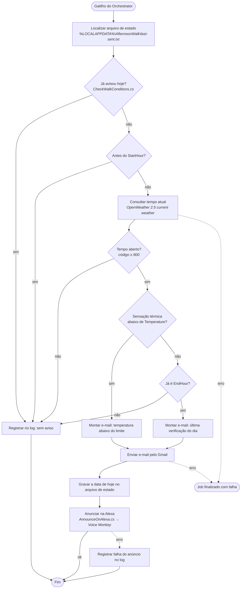

# Fluxo do processo – Afternoon Walk

Este documento descreve, passo a passo, o que o robô faz em cada execução. O ponto de entrada é o
[`Main.xaml`](Main.xaml); as regras ficam em [`CheckWalkConditions.cs`](CheckWalkConditions.cs) e o anúncio
em [`AnnounceOnAlexa.cs`](AnnounceOnAlexa.cs).

## Visão geral

Os gatilhos do Orchestrator iniciam o robô a cada 10 minutos entre 18:00 e 19:50 e mais uma vez às 20:00.
Em cada execução, o robô decide se este é um bom momento para o passeio. Se for, envia um e-mail e faz um
anúncio na Alexa. O aviso sai no máximo uma vez por dia.

## Diagrama

## Etapas

| # | Etapa | Onde | O que faz |
|---|-------|------|-----------|
| 1 | Arquivo de estado | `Main.xaml` | Monta o caminho de `%LOCALAPPDATA%\AfternoonWalk\last-sent.txt`, que guarda a data do último aviso. |
| 2 | Já avisou hoje? | `CheckWalkConditions.cs` | Se a data do arquivo for a de hoje (fuso `America/Sao_Paulo`), termina sem fazer nada. |
| 3 | Janela de horário | `CheckWalkConditions.cs` | Antes do horário do asset `StartHour`, termina sem consultar a API. |
| 4 | Tempo atual | `CheckWalkConditions.cs` | Uma chamada à API gratuita 2.5 da OpenWeather para `Latitude`/`Longitude`. Lê a sensação térmica e o código da condição. |
| 5 | Tempo aberto? | `CheckWalkConditions.cs` | Só segue se o código da condição for ≥ 800 (céu limpo ou nuvens). |
| 6 | Regra da temperatura | `CheckWalkConditions.cs` | Avisa se a sensação térmica estiver abaixo do asset `Temperature`. Se não estiver, só avisa na última verificação (a partir de `EndHour`). |
| 7 | E-mail | `Main.xaml` | Envia o e-mail em português pela conexão do Gmail no Integration Service para o asset `Recipient`. |
| 8 | Gravar estado | `Main.xaml` | Grava a data de hoje no arquivo de estado, para não avisar de novo no mesmo dia. |
| 9 | Anúncio na Alexa | `AnnounceOnAlexa.cs` | Chama a API do Voice Monkey com o texto de `VoiceMonkeySpeech` + a sensação térmica (ex.: *"Hora do passeio! - A temperatura é 23,5°C"*). |

## Entradas

**Assets do Orchestrator** (pasta `AfternoonWalk`): `OpenWeatherMapApiKey`, `VoiceMonkeyApiKey`,
`VoiceMonkeyDeviceID`, `VoiceMonkeySpeech`, `Recipient`, `Latitude`, `Longitude`, `StartHour`, `EndHour` e
`Temperature`. Detalhes de cada um no [README](README.md#configuração-no-orchestrator).

## Saídas

- **E-mail de aviso**, com um de dois assuntos:
  - `Sensação térmica de 23,5°C (abaixo de 26°C)`, quando a temperatura ficou abaixo do limite;
  - `Ainda 27°C às 20:00`, na última verificação do dia, quando não ficou abaixo do limite.
- **Anúncio na Alexa** pelo Voice Monkey.
- **Arquivo de estado** `last-sent.txt` com a data do aviso.

## Regras de exceção

| Situação | O que acontece |
|----------|----------------|
| Já avisou hoje, antes do `StartHour`, tempo fechado ou ainda quente antes do `EndHour` | Registra o motivo no log e termina **sem aviso**. Uma próxima execução tenta de novo. |
| Asset vazio ou em formato inválido | Erro com o nome do asset; o job termina **com falha**. |
| Falha na API da OpenWeather ou no envio do e-mail | O job termina **com falha** e o estado não é gravado, então a próxima execução tenta de novo. |
| Falha no anúncio da Alexa | O e-mail já enviado vale; a falha fica só no log e o job termina com sucesso. |
| `VoiceMonkeyDeviceID` ou `VoiceMonkeySpeech` vazios | O anúncio é pulado, com um aviso no log. |

## Sistemas envolvidos

- **OpenWeather** (API 2.5 *current weather*): tempo e sensação térmica
- **Gmail** (UiPath Integration Service): envio do e-mail
- **Voice Monkey** + **Amazon Alexa**: anúncio por voz
- **UiPath Orchestrator**: assets, gatilhos e robô não assistido
